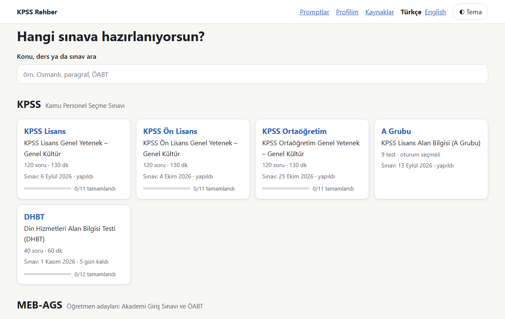

# KPSS Rehber

[English](README.md) · **Türkçe**

KPSS ve MEB-AGS'ye hazırlananlar için **ücretsiz, ticari olmayan** bir çalışma rehberi: tüm müfredatın haritası, konuların promptsuz statik özetleri ve kendi ChatGPT ya da Claude hesabında kullanabileceğin hazır prompt setleri. Site Türkçe ve İngilizce olarak kullanılabilir.

**Site:** https://unseensenpai.github.io/kpss-rehber/



## Ne var?

- **Müfredat ağacı:** sınav → oturum → test → ders → konu. Soru sayıları, süreler ve sınav tarihleri resmi ÖSYM belgelerinden alınır; her kayıt kaynağını ve yılını gösterir.
- **Konu sayfaları:** statik özet, konunun hangi sınavlarda geçtiği, ÖSYM soru kitapçığı bağlantıları ve "Hata bildir" bağlantısı.
- **Hazır promptlar:** konuyu anlat, örnek soru üret, adım adım çözüm, yanlış analizi, bilgi kartları, çalışma planı (Güncel Bilgiler için ayrıca güncel olaylar listesi). Seviye (1–5) ve uzunluk seçilir; geri bildirimle konu bazında uyarlanır. **Kopyala**, **ChatGPT'de aç**, **Claude'da aç**.
- **İlerleme ve yedek:** konuları çalışıyorum / tamamlandı / tekrar edilecek olarak işaretle, not al, ilerleme çubuklarını gör; ilerlemeni JSON yedeğiyle başka bir bilgisayara taşı.
- **Arama:** dile göre site içi tam metin arama (Pagefind, tarayıcıda çalışır).
- **Gizlilik:** hesap, sunucu, çerez ve analitik yok. İlerleme yalnızca senin tarayıcında tutulur.

## Kapsanan sınavlar (2026)

| Sınav | Yapı |
|---|---|
| KPSS Lisans, Ön Lisans, Ortaöğretim | Genel Yetenek 60 + Genel Kültür 60 soru, 130 dk |
| KPSS Lisans Alan Bilgisi (A Grubu) | 9 test, 40'ar soru, 3 oturum |
| DHBT | 40 soru, 60 dk |
| MEB-AGS | 80 soru, 110 dk (Eğitim Bilimleri artık burada) |
| ÖABT | 17 alan, 50'şer soru, 70/90 dk |

Ayrıntılar ve resmi belgeler sitedeki **Kaynaklar** sayfasında.

## Yerelde çalıştırma

```bash
npm ci
npm run dev        # http://localhost:4321/kpss-rehber/
```

```bash
npm test           # birim testleri
npm run test:e2e   # uçtan uca testler (build + önizleme)
npm run build      # dist/ + arama dizini
```

Node 22 gerekir. Astro (statik çıktı), Vitest, Playwright ve Pagefind kullanılır.

## Proje yapısı

| Yol | İçerik |
|---|---|
| `src/content/exams/*.yaml` | Sınav → oturum → test → ders → konu referansları |
| `src/content/topics/<dil>/<ders>/<slug>.md` | Konu bilgileri ve statik özet, her dil için bir dosya |
| `src/prompts/templates/<dil>/*.md` | Prompt şablonları, her dil için bir klasör |
| `src/prompts/levels.yaml`, `lengths.yaml` | Seviye ve uzunluk talimatları |
| `src/i18n/` | Arayüz sözlükleri (`tr.js`, `en.js`) ve yardımcılar |
| `data/sources.json`, `data/calendar.yaml` | Takip edilen ÖSYM belgeleri; başvuru ve sınav tarihleri |

Tüm veri build sırasında doğrulanır: bozuk referans, kaynaksız kayıt, tutmayan soru toplamı, eksik çeviri ya da doldurulmamış şablon değişkeni build'i kırar. Ayrıntılar için [CONTRIBUTING.tr.md](CONTRIBUTING.tr.md).

Yanlış ya da eski bir bilgi gördüysen sayfadaki **Hata bildir** bağlantısını kullan.

## Lisans

- Kod: [MIT](LICENSE)
- İçerik (konu metinleri ve prompt şablonları): [CC BY-SA 4.0](LICENSE-CONTENT)
- ÖSYM belgeleri ve soru kitapçıkları ÖSYM'ye aittir; bu repoda yalnızca bağlantıları bulunur.

## Sorumluluk reddi

Bu site **ÖSYM ile bağlantılı değildir**. Bilgiler resmi belgelerden derlenir ancak hata içerebilir; konu özetleri yapay zekâ desteğiyle hazırlanabilir. Başvuru, sınav ve sonuçlarla ilgili kesin bilgi için her zaman [osym.gov.tr](https://www.osym.gov.tr) adresini esas al.
